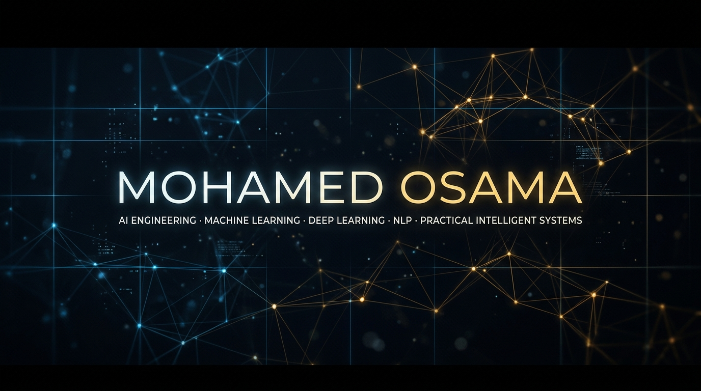

<div align="center">

# 🎬 A CINEMATIC AI ENGINEERING PROFILE · MOHAMED OSAMA

**Applied AI & Machine Learning Engineer · Cairo, Egypt**  
*Designing Practical Intelligent Systems · Industrial Cognitive Architectures · Calibrated Predictive ML*

<br/>

[](https://www.linkedin.com/in/mohamedosama-ai)
[](https://mohamed-osama-ai-portfol-ae5i1zi.gamma.site)
[](https://github.com/Mohamed-Osama-ai7)
[](mailto:mohamedosama17122006@gmail.com)

<br/>



</div>

<br/>

<div align="center">
─────── ◇ ───────
</div>

## 🎬 The Point of View

> *"Engineering applied AI systems that convert noisy operational telemetry, unstructured text, and enterprise risk signals into calibrated, deterministic decision engines."*

```text
[SYSTEM_ID]   : MOHAMED-OSAMA-AI7
[ROLE]        : Applied AI & Machine Learning Engineer
[LOCATION]    : Cairo, Egypt
[PILLARS]     : Machine Learning · Deep Learning · Natural Language Processing · Industrial AI
[PARADIGM]    : Leak-Free Preprocessing · Explainable Attribution (SHAP) · Reproducible Pipelines
```

<div align="center">
─────── ◇ ───────
</div>

## 🏭 Leading Production: FactoryMind-CDT

### [FactoryMind-CDT](https://github.com/Mohamed-Osama-ai7/FactoryMind-CDT) — Cognitive Digital Twin Framework
*Architectural Specification & Conceptual Engineering Design (Active R&D)*

An industrial AI framework designed to bridge continuous IIoT sensor telemetry with predictive maintenance intelligence and closed-loop decision reasoning in high-throughput manufacturing plants.

```
  ┌───────────┐      ┌──────────────┐      ┌────────────┐      ┌───────────┐      ┌───────────┐
  │   SENSE   │ ───► │  UNDERSTAND  │ ───► │  SIMULATE  │ ───► │  DECIDE   │ ───► │   LEARN   │
  └───────────┘      └──────────────┘      └────────────┘      └───────────┘      └───────────┘
   Multi-sensor       Anomaly Scoring       Degradation          Prescriptive      Closed-Loop
    Telemetry           & Signatures         & RUL Curve         Intervention       Feedback
```

* **SENSE**: Edge aggregation and DSP filtering for multi-modal telemetry streams (vibration accelerometry, thermal transients, acoustic emissions, pressure).
* **UNDERSTAND**: Real-time spectral FFT feature extraction coupled with unsupervised anomaly scoring (Isolation Forests / Autoencoder reconstruction error) to detect micro-faults prior to critical failure.
* **SIMULATE**: Dynamic physics-informed degradation trajectories and Weibull hazard estimation to project Remaining Useful Life (RUL) under variable operational loads.
* **DECIDE**: Prescriptive maintenance dispatching calibrated against ISO 10816 vibration severity standards, routing automated work orders with root-cause attribution.
* **LEARN**: Continuous feedback loop updating sensor baseline thresholds using post-intervention maintenance logs.

[](https://github.com/Mohamed-Osama-ai7/FactoryMind-CDT)
[](https://github.com/Mohamed-Osama-ai7/FactoryMind-CDT)
[](https://github.com/Mohamed-Osama-ai7/FactoryMind-CDT)

`Python` `Industrial AI` `Edge ML` `Signal DSP (FFT)` `Digital Twins` `OPC-UA / MQTT` `TimescaleDB`

<div align="center">
─────── ◇ ───────
</div>

## 📽️ Featured Reel

### 1. [InvoiceGuard AI](https://github.com/Mohamed-Osama-ai7/Inovice-Guard-ai) — Enterprise Receivables Intelligence
**Multi-Signal Financial Risk Engine & Interactive Decision Console**  
Predicts commercial late-payment risk, quantifies revenue exposure, and extracts customer sentiment from unstructured communication history.
* **Architecture**: Deploys five concurrent scikit-learn models (binary payment risk classification, days-late regression, dispute NLP, repurchase scoring, and future revenue estimation).
* **Explainability & Controls**: Full SHAP TreeExplainer feature attribution for every prediction, multi-signal composite risk scoring, deterministic P1–P4 action playbooks, and PBKDF2-HMAC authenticated RBAC security.

[](https://inovice-guard-ai-17.streamlit.app/)
[](https://github.com/Mohamed-Osama-ai7/Inovice-Guard-ai)  
`Python` `scikit-learn` `XGBoost` `SHAP` `FastAPI` `Streamlit` `PBKDF2-HMAC`

---

### 2. [Enterprise Customer Churn AI](https://github.com/Mohamed-Osama-ai7/enterprise-customer-churn-ai) — Retention Analytics Engine
**14-Model Classical ML Benchmark & Production Diagnostic Platform**  
End-to-end customer churn prediction platform built to test, calibrate, and serve classical ML algorithms without deep learning overhead.
* **Benchmarking**: Rigorously benchmarked 14 algorithms — **Logistic Regression Champion (81.4% Accuracy, 0.834 ROC-AUC, 69.9% Precision)**, **Stacking Meta-Ensemble (80.4% Accuracy, 0.828 ROC-AUC)**, LDA, and Gradient Boosting ensembles.
* **Leak-Free Engineering**: `RobustScaler` preprocessing for skewed billing distributions, `ColumnTransformer` encapsulation, automated business ratios (`ChargesPerTenure`), and unsupervised K-Means customer persona segmentation.
* **Production Serving**: Interactive Streamlit diagnostic console for single-customer simulation and batch CSV scoring, containerized with Docker & Docker-Compose and validated with GitHub Actions CI/CD.

[](https://github.com/Mohamed-Osama-ai7/enterprise-customer-churn-ai)
[](https://github.com/Mohamed-Osama-ai7/enterprise-customer-churn-ai)  
`Python` `scikit-learn` `Stacking Meta-Learner` `Docker` `Streamlit` `GitHub Actions`

---

### 3. [Promise Guard](https://github.com/Mohamed-Osama-ai7/promise-guard) — Corporate Commitment Risk Engine
**NLP Analysis & Transformer-Based Delivery Scoring**  
Analyzes executive commitments and enterprise statements to extract deliverables, deadlines, and delivery confidence scores.
* **NLP Pipeline**: Combines TF-IDF text vectorization, transformer-based RoBERTa sentiment modeling, and a Random Forest risk classifier to evaluate corporate accountability across historical quarters.
* **Interface**: Interactive Streamlit monitoring dashboard tracking multi-quarter delivery confidence.

[](https://github.com/Mohamed-Osama-ai7/promise-guard)  
`Python` `NLP` `RoBERTa` `Transformers` `scikit-learn` `Streamlit`

<div align="center">
─────── ◇ ───────
</div>

## 🎨 Production Palette

A focused, verified engineering toolkit chosen for mathematical rigor and operational reliability:

```text
MACHINE LEARNING     · scikit-learn · XGBoost · LightGBM · CatBoost · Stacking / Voting Ensembles · Isotonic Calibration
DEEP LEARNING & NLP  · PyTorch · HuggingFace Transformers · RoBERTa · TF-IDF · Entity Extraction
MODEL EXPLAINABILITY · SHAP (TreeExplainer / KernelExplainer) · Permutation Importance · Feature Attribution
SERVING & DEVOPS     · FastAPI · Pydantic v2 · Streamlit · Docker · Docker-Compose · GitHub Actions CI/CD
DATA & TELEMETRY     · Pandas · NumPy · SciPy · ColumnTransformers · Signal DSP (FFT) · OPC-UA / MQTT
```

<div align="center">
─────── ◇ ───────
</div>

## 📊 Telemetry & System Activity

<div align="center">


&nbsp;


</div>

<div align="center">
─────── ◇ ───────
</div>

## 🎬 The Next Scene: Connect & Collaborate

I build with engineering teams and technical leaders focused on solving tangible operational problems with explainable, production-ready machine learning.

* **LinkedIn**: [linkedin.com/in/mohamedosama-ai](https://www.linkedin.com/in/mohamedosama-ai)
* **Interactive Portfolio**: [mohamed-osama-ai-portfol-ae5i1zi.gamma.site](https://mohamed-osama-ai-portfol-ae5i1zi.gamma.site)
* **GitHub**: [github.com/Mohamed-Osama-ai7](https://github.com/Mohamed-Osama-ai7)
* **Email**: [mohamedosama17122006@gmail.com](mailto:mohamedosama17122006@gmail.com)

<br/>

<div align="center">
<sub>Designed with the GitSkins Cinematic visual framework · Mohamed Osama © 2026</sub>
</div>
