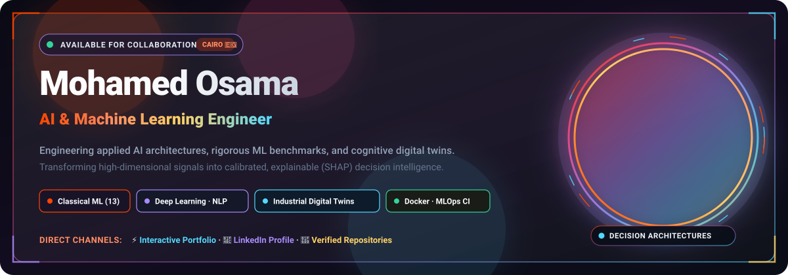
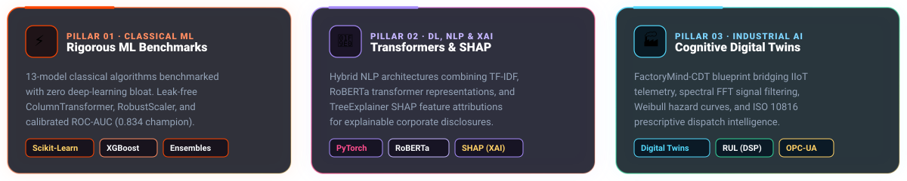
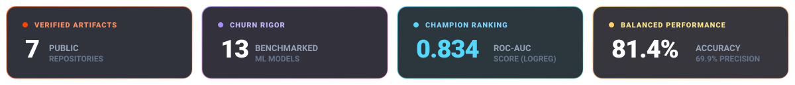
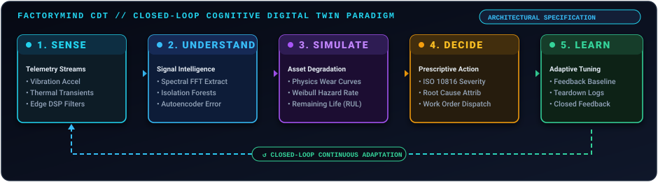

<!-- HERO GLASSMORPHISM SECTION -->

  

<!-- TOP CALL TO ACTION BUTTONS -->

  
  &nbsp;&nbsp;
  
  &nbsp;&nbsp;
  

<!-- SECTION DIVIDER -->

 

## 💎 The Engineering Pillars

  

 

  

 

## 📊 Proof &amp; Telemetry at a Glance

  <!-- Custom Glass Metric Badges -->
  
  
    

  <!-- Live Dynamic GitSkins Statistics -->
  <picture>
    <source media="(prefers-color-scheme: light)" srcSet="https://www.gitskins.com/api/section/stats?username=Mohamed-Osama-ai7&amp;theme=satan&amp;avatar=https%3A%2F%2Favatars.githubusercontent.com%2Fu%2F277105326%3Fv%3D4&amp;v=recruiter-stats-1&amp;mode=light"/>
    
  </picture>

 

  

 

## 🚀 Featured Engineering Showcase

<!-- FLAGSHIP 01: FactoryMind-CDT -->
<table width="100%">
  <tr>
    <td colspan="2" bgcolor="#0d141e" style="border-left: 4px solid #53D8FB; padding: 14px;">
      <h3 style="color:#53D8FB; margin: 0; font-size: 19px;">
        🏭 FLAGSHIP · FactoryMind-CDT — Cognitive Digital Twin Framework
      </h3>
      

        <em>Industrial Decision Intelligence Platform · Conceptual Engineering Design &amp; Architecture Specification (R&amp;D Initiative)</em>
      

    </td>
  </tr>
  <tr>
    <td width="60%" valign="top">
      

        An industrial AI architecture engineered to bridge continuous IIoT sensor telemetry with predictive asset health assessment and prescriptive closed-loop decision reasoning in high-throughput manufacturing plants.
      

      

        <strong><code>SENSE • UNDERSTAND • SIMULATE • DECIDE • LEARN</code></strong>
      

      <ul>
        <li><strong>01 · SENSE (Proposed):</strong> Specification for high-frequency accelerometry, thermal transients, acoustic emissions, and pressure acquisition with edge DSP filtering.</li>
        <li><strong>02 · UNDERSTAND (Proposed):</strong> Spectral FFT feature extraction and unsupervised anomaly scoring (Isolation Forests / Autoencoders) to isolate micro-fault signatures.</li>
        <li><strong>03 · SIMULATE (Proposed):</strong> Physics-informed degradation curves and Weibull hazard estimation to simulate Remaining Useful Life (RUL) trajectories.</li>
        <li><strong>04 · DECIDE &amp; LEARN (Proposed):</strong> ISO 10816 calibrated dispatch matrix with closed-loop threshold adaptation from teardown logs.</li>
      </ul>
      

        
        &nbsp;
        
        &nbsp;
        
      

    </td>
    <td width="40%" align="center" valign="middle">
      
    </td>
  </tr>
</table>

 

<!-- PROJECT 02: Enterprise Customer Churn AI -->
<table width="100%">
  <tr>
    <td colspan="2" bgcolor="#150E24" style="border-left: 4px solid #A78BFA; padding: 14px;">
      <h3 style="color:#A78BFA; margin: 0; font-size: 19px;">
        ⚡ 02 · Enterprise Customer Churn AI — Retention Analytics Platform
      </h3>
      

        <em>13-Model Classical ML Benchmark &amp; Containerized Diagnostic Serving Engine</em>
      

    </td>
  </tr>
  <tr>
    <td width="65%" valign="top">
      

        End-to-end customer churn prediction and retention analytics platform engineered to test, calibrate, and deploy classical ML algorithms with zero deep learning bloat.
      

      <ul>
        <li><strong>13-Model Rigorous Benchmark:</strong> Evaluated 13 algorithms — <strong>Logistic Regression Champion (81.4% Accuracy, 0.834 ROC-AUC, 69.9% Precision)</strong>, <strong>Stacking Meta-Ensemble (80.4% Accuracy, 0.828 ROC-AUC)</strong>, Linear Discriminant Analysis, and Gradient Boosting ensembles.</li>
        <li><strong>Leak-Free Preprocessing:</strong> <code>RobustScaler</code> handling skewed billing metrics, <code>ColumnTransformer</code> pipeline isolation, and unsupervised K-Means customer persona clustering.</li>
        <li><strong>Production Containerization:</strong> Interactive Streamlit diagnostic console containerized with Docker &amp; Docker-Compose and verified via GitHub Actions CI/CD workflows.</li>
      </ul>
      

        
      

    </td>
    <td width="35%" valign="top">
      

         
         
         
         
        
      

    </td>
  </tr>
</table>

 

<!-- PROJECT 03: InvoiceGuard AI -->
<table width="100%">
  <tr>
    <td colspan="2" bgcolor="#1A0E10" style="border-left: 4px solid #FF4500; padding: 14px;">
      <h3 style="color:#FF4500; margin: 0; font-size: 19px;">
        🛡️ 03 · InvoiceGuard AI — Enterprise Receivables Intelligence
      </h3>
      

        <em>Multi-Signal Financial Risk Engine &amp; Interactive Decision Console</em>
      

    </td>
  </tr>
  <tr>
    <td width="65%" valign="top">
      

        End-to-end financial intelligence engine that predicts commercial late-payment risk, quantifies revenue exposure, and extracts customer sentiment from unstructured communication trails.
      

      <ul>
        <li><strong>Multi-Model Architecture:</strong> Deploys 5 concurrent scikit-learn models covering binary payment risk classification, days-late regression, dispute risk NLP, repurchase scoring, and future revenue estimation.</li>
        <li><strong>Explainability &amp; Controls:</strong> SHAP TreeExplainer feature attributions for risk assessment, multi-signal composite risk scoring, deterministic P1–P4 action playbooks, and PBKDF2-HMAC authenticated RBAC security.</li>
        <li><strong>Interactive Serving:</strong> Interactive Streamlit dashboard providing single-invoice inspection and bulk portfolio stress-testing <em>(Auth required for live cloud demo)</em>.</li>
      </ul>
      

        
        &nbsp;
        
      

    </td>
    <td width="35%" valign="top">
      

         
         
         
         
        
      

    </td>
  </tr>
</table>

 

<!-- PROJECT 04: Promise Guard -->
<table width="100%">
  <tr>
    <td colspan="2" bgcolor="#1D0E17" style="border-left: 4px solid #FF4D8D; padding: 14px;">
      <h3 style="color:#FF4D8D; margin: 0; font-size: 19px;">
        🎯 04 · Promise Guard — Corporate Commitment Risk Engine
      </h3>
      

        <em>NLP Analysis &amp; Transformer-Based Delivery Confidence Scoring</em>
      

    </td>
  </tr>
  <tr>
    <td width="65%" valign="top">
      

        Natural language processing engine that analyzes corporate disclosures, earnings transcripts, and executive commitments to extract deliverables, deadlines, and delivery risk scores.
      

      <ul>
        <li><strong>Hybrid NLP Pipeline:</strong> Combines TF-IDF term vectorization, transformer-based RoBERTa sentiment modeling, and Random Forest risk classification to evaluate multi-quarter accountability.</li>
        <li><strong>Commitment Tracking:</strong> Identifies forward-looking delivery promises and quantifies organizational delivery risk through historical trend analytics.</li>
      </ul>
      

        
      

    </td>
    <td width="35%" valign="top">
      

         
         
         
        
      

    </td>
  </tr>
</table>

 

<!-- LIVE GITSKINS PROJECT VISUALIZER -->

  <picture>
    <source media="(prefers-color-scheme: light)" srcSet="https://www.gitskins.com/api/section/projects?username=Mohamed-Osama-ai7&amp;theme=satan&amp;avatar=https%3A%2F%2Favatars.githubusercontent.com%2Fu%2F277105326%3Fv%3D4&amp;repos=Mohamed-Osama-ai7%2FFactoryMind-CDT%2CMohamed-Osama-ai7%2Fenterprise-customer-churn-ai%2CMohamed-Osama-ai7%2FInovice-Guard-ai%2CMohamed-Osama-ai7%2Fpromise-guard&amp;v=recruiter-projects-1&amp;mode=light"/>
    
  </picture>

 

  

 

## 🛠️ The Technical Toolkit

<table width="100%">
  <tr>
    <th width="33%" style="color:#FF4500;">⚡ Machine Learning</th>
    <th width="33%" style="color:#A78BFA;">🧠 Deep Learning &amp; NLP</th>
    <th width="34%" style="color:#53D8FB;">🔍 Explainability &amp; Validation</th>
  </tr>
  <tr>
    <td valign="top">
       
       
       
       
      
    </td>
    <td valign="top">
       
       
       
       
      
    </td>
    <td valign="top">
       
       
       
       
      
    </td>
  </tr>
  <tr>
    <th width="33%" style="color:#FFD166;">📊 Scientific Computing &amp; Data</th>
    <th width="33%" style="color:#34D399;">🌐 Serving &amp; Full-Stack</th>
    <th width="34%" style="color:#FF4D8D;">⚙️ DevOps &amp; Engineering</th>
  </tr>
  <tr>
    <td valign="top">
       
       
       
       
      
    </td>
    <td valign="top">
       
       
       
       
      
    </td>
    <td valign="top">
       
       
       
       
      
    </td>
  </tr>
</table>

 

<!-- DYNAMIC GITSKINS TECH STACK CARD -->

  <picture>
    <source media="(prefers-color-scheme: light)" srcSet="https://www.gitskins.com/api/section/stack?username=Mohamed-Osama-ai7&amp;theme=satan&amp;avatar=https%3A%2F%2Favatars.githubusercontent.com%2Fu%2F277105326%3Fv%3D4&amp;v=recruiter-stack-1&amp;mode=light"/>
    
  </picture>

 

  

 

## 📈 Consistency &amp; Activity Telemetry

  <picture>
    <source media="(prefers-color-scheme: light)" srcSet="https://www.gitskins.com/api/section/heatmap?username=Mohamed-Osama-ai7&amp;theme=satan&amp;avatar=https%3A%2F%2Favatars.githubusercontent.com%2Fu%2F277105326%3Fv%3D4&amp;v=recruiter-heatmap-1&amp;mode=light"/>
    
  </picture>

 

  

 

## 🤝 Connect &amp; Collaborate

<table width="100%">
  <tr>
    <td align="center" bgcolor="#0d111a" style="border: 2px solid #FF4500; border-radius: 12px; padding: 28px;">
      <h3 style="color:#FF4500; margin-top: 0; font-size: 22px; letter-spacing: 0.5px;">
        ⚡ READY TO SCALE INTELLIGENT SYSTEMS
      </h3>
      

        I partner with engineering teams, technology leaders, and AI innovators focused on building high-impact, deterministic machine learning architectures, industrial cognitive digital twins, and explainable AI models.
      

       
      

        
        &nbsp;&nbsp;
        
        &nbsp;&nbsp;
        
      

       
      

        📍 Cairo, Egypt · Open to Remote &amp; International Relocation Opportunities
      

    </td>
  </tr>
</table>

 

Curated with a custom Glassmorphic Design System · Mohamed Osama © 2026

