<!-- HERO BANNER -->

  

<!-- TOP STATUS BADGES -->

  
  &nbsp;
  
  &nbsp;
  
  &nbsp;
  
  &nbsp;
  

<!-- JUMP NAVIGATION BAR -->

  
  &nbsp;
  
  &nbsp;
  
  &nbsp;
  
  &nbsp;
  
  &nbsp;
  

 

## 🔮 The Engineering Philosophy

<table width="100%">
  <tr>
    <td width="55%" valign="top">
      <h3>⚡ Point of View</h3>
      

        I engineer <strong>applied AI and machine learning systems</strong> that transform noisy operational telemetry, unstructured text, and multi-variable enterprise signals into <strong>calibrated, deterministic, and explainable decision architectures</strong>.
      

      

        Rather than chasing ungrounded black-box models, my engineering focus centers on mathematical rigor, leak-free preprocessing, interpretable feature attributions (SHAP), and high-reliability pipelines built for tangible production impact.
      

      

        
        
        
        
      

    </td>
    <td width="45%" valign="top">
      <h3>🛰️ System Telemetry</h3>
      <ul>
        <li><strong>Role:</strong> Applied AI & Machine Learning Engineer</li>
        <li><strong>Core Pillars:</strong> Classical ML · Deep Learning · NLP · Industrial AI</li>
        <li><strong>Deployment:</strong> Docker · Streamlit · GitHub Actions CI/CD</li>
        <li><strong>Full-Stack:</strong> Angular · Node.js · Express · MongoDB</li>
        <li><strong>Target Domains:</strong> Industrial Digital Twins · Enterprise Risk · NLP</li>
        <li><strong>Location:</strong> Cairo, Egypt 🇪🇬 (Remote / Global Relocation)</li>
      </ul>
    </td>
  </tr>
</table>

 

  

 

## 🏭 Flagship Initiative: FactoryMind-CDT

### [FactoryMind-CDT](https://github.com/Mohamed-Osama-ai7/FactoryMind-CDT) — Cognitive Digital Twin Framework
**Industrial Decision Intelligence Platform · Conceptual Engineering Design & Architecture (R&D Initiative)**

  

  

An ambitious industrial AI architecture engineered to bridge continuous IIoT sensor telemetry with predictive maintenance intelligence and closed-loop decision reasoning in high-throughput manufacturing plants.

<table width="100%">
  <tr>
    <th width="20%" style="color:#22D3EE;">01 · SENSE</th>
    <th width="20%" style="color:#38BDF8;">02 · UNDERSTAND</th>
    <th width="20%" style="color:#A855F7;">03 · SIMULATE</th>
    <th width="20%" style="color:#F59E0B;">04 · DECIDE</th>
    <th width="20%" style="color:#34D399;">05 · LEARN</th>
  </tr>
  <tr>
    <td valign="top">
      <strong>Multi-Sensor Telemetry</strong> 
      High-frequency vibration accelerometry, thermal transients, acoustic emissions, and pressure acquisition with edge digital signal processing (DSP) filtering specifications.
    </td>
    <td valign="top">
      <strong>Anomaly Scoring & Signatures</strong> 
      Spectral FFT feature extraction coupled with unsupervised anomaly scoring (Isolation Forests / Autoencoders) to identify micro-fault signatures before catastrophic failure.
    </td>
    <td valign="top">
      <strong>Degradation & RUL Modeling</strong> 
      Physics-informed degradation curves and Weibull hazard rate estimation to project Remaining Useful Life (RUL) under dynamic production loads.
    </td>
    <td valign="top">
      <strong>Prescriptive Intervention</strong> 
      Automated maintenance dispatching calibrated against ISO 10816 vibration standards, generating prioritized work orders with root-cause attribution.
    </td>
    <td valign="top">
      <strong>Closed-Loop Feedback</strong> 
      Feedback protocol that continuously recalibrates sensor baseline thresholds using post-intervention teardown logs and component lifecycle history.
    </td>
  </tr>
</table>

> ℹ️ **Status & Scope Verification:** FactoryMind-CDT is an **Architectural Specification and Conceptual System Blueprint**. The core system models, state machines, and mathematical specifications are documented in the repository. Physical multi-sensor hardware ingestion, real-time edge streaming, and distributed microservices represent target design capabilities.

   
  
  &nbsp;
  
  &nbsp;
  
  &nbsp;
  
    
  <code>Industrial AI</code> · <code>Cognitive Digital Twins</code> · <code>Edge Telemetry</code> · <code>Signal DSP (FFT)</code> · <code>Predictive Maintenance</code> · <code>OPC-UA / MQTT</code>

 

  

 

## 🚀 Featured AI Showcase

<table width="100%">
  <!-- PROJECT 1: INVOICEGUARD AI -->
  <tr>
    <td colspan="2" bgcolor="#0A1612" style="border-left: 4px solid #34D399; padding: 12px;">
      <h3 style="color:#34D399; margin: 0;">01 · InvoiceGuard AI — Enterprise Receivables Intelligence</h3>
      
<em>Multi-Signal Financial Risk Engine & Interactive Decision Console</em>

    </td>
  </tr>
  <tr>
    <td width="65%" valign="top">
      

        Production-grade financial intelligence engine that predicts commercial late-payment risk, quantifies revenue exposure, and extracts customer sentiment from unstructured communication trails.
      

      <ul>
        <li><strong>Multi-Model Architecture:</strong> Deploys 5 concurrent scikit-learn models covering binary payment risk classification, days-late regression, dispute risk NLP, repurchase scoring, and future revenue estimation.</li>
        <li><strong>Explainability & Controls:</strong> Full SHAP TreeExplainer feature attribution for every invoice, multi-signal composite risk scoring, deterministic P1–P4 action playbooks, and PBKDF2-HMAC authenticated RBAC security.</li>
        <li><strong>Interactive Serving:</strong> Real-time Streamlit dashboard providing single-invoice inspection and bulk portfolio stress-testing.</li>
      </ul>
      

        
        &nbsp;
        
      

    </td>
    <td width="35%" valign="top">
      

         
         
         
         
        
      

    </td>
  </tr>

  <!-- PROJECT 2: CUSTOMER CHURN AI -->
  <tr>
    <td colspan="2" bgcolor="#150E24" style="border-left: 4px solid #A855F7; padding: 12px;">
      <h3 style="color:#A855F7; margin: 0;">02 · Enterprise Customer Churn AI — Retention Analytics Engine</h3>
      
<em>13-Model Classical ML Benchmark & Containerized Scoring Platform</em>

    </td>
  </tr>
  <tr>
    <td width="65%" valign="top">
      

        End-to-end customer churn prediction and retention analytics platform engineered to test, calibrate, and deploy classical ML algorithms with zero deep learning bloat.
      

      <ul>
        <li><strong>13-Model Rigorous Benchmark:</strong> Evaluated 13 algorithms — <strong>Logistic Regression Champion (81.4% Accuracy, 0.834 ROC-AUC, 69.9% Precision)</strong>, <strong>Stacking Meta-Ensemble (80.4% Accuracy, 0.828 ROC-AUC)</strong>, Linear Discriminant Analysis, and Gradient Boosting ensembles. Champion selected for superior ROC-AUC ranking power and balanced operational precision/recall.</li>
        <li><strong>Leak-Free Preprocessing:</strong> <code>RobustScaler</code> handling skewed billing metrics, <code>ColumnTransformer</code> pipeline isolation, automated business ratios (<code>ChargesPerTenure</code>), and unsupervised K-Means customer persona clustering.</li>
        <li><strong>Production Containerization:</strong> Interactive Streamlit diagnostic console containerized with Docker & Docker-Compose and verified via GitHub Actions CI/CD workflows.</li>
      </ul>
      

        
      

    </td>
    <td width="35%" valign="top">
      

         
         
         
         
        
      

    </td>
  </tr>

  <!-- PROJECT 3: PROMISE GUARD -->
  <tr>
    <td colspan="2" bgcolor="#1D0E17" style="border-left: 4px solid #FB7185; padding: 12px;">
      <h3 style="color:#FB7185; margin: 0;">03 · Promise Guard — Corporate Commitment Risk Engine</h3>
      
<em>NLP Analysis & Transformer-Based Delivery Confidence Scoring</em>

    </td>
  </tr>
  <tr>
    <td width="65%" valign="top">
      

        Natural language processing engine that analyzes corporate disclosures, earnings transcripts, and executive commitments to extract deliverables, deadlines, and delivery risk scores.
      

      <ul>
        <li><strong>Hybrid NLP Pipeline:</strong> Combines TF-IDF term vectorization, transformer-based RoBERTa sentiment modeling, and Random Forest risk classification to evaluate multi-quarter accountability.</li>
        <li><strong>Commitment Tracking:</strong> Identifies forward-looking delivery promises and quantifies organizational delivery risk through historical trend analytics.</li>
        <li><strong>Interactive Interface:</strong> Streamlit monitoring console tracking multi-quarter delivery confidence.</li>
      </ul>
      

        
      

    </td>
    <td width="35%" valign="top">
      

         
         
         
         
        
      

    </td>
  </tr>

  <!-- PROJECT 4: FULL-STACK & MEAN -->
  <tr>
    <td colspan="2" bgcolor="#0A161C" style="border-left: 4px solid #22D3EE; padding: 12px;">
      <h3 style="color:#22D3EE; margin: 0;">04 · Full-Stack Systems & MEAN Architecture</h3>
      
<em>Component-Driven Frontends & Scalable Micro-Services for AI Delivery</em>

    </td>
  </tr>
  <tr>
    <td width="65%" valign="top">
      

        Supplementary software engineering expertise bridging data science models with production web interfaces, scalable REST APIs, and document database backends.
      

      <ul>
        <li><strong>Frontend Architecture:</strong> Modular Angular single-page applications with reactive state management, clean component hierarchies, and real-time visualization widgets.</li>
        <li><strong>Backend Microservices:</strong> Node.js and Express.js RESTful service architectures with structured JSON schema validation and JWT authentication.</li>
        <li><strong>Data Persistence:</strong> MongoDB document modeling, indexing strategies, and aggregation pipelines.</li>
      </ul>
    </td>
    <td width="35%" valign="top">
      

         
         
         
         
        
      

    </td>
  </tr>
</table>

 

  

 

## 🛠️ The Technical Toolkit

<table width="100%">
  <tr>
    <th width="33%" style="color:#38BDF8;">🤖 Machine Learning</th>
    <th width="33%" style="color:#A855F7;">🧠 Deep Learning & NLP</th>
    <th width="34%" style="color:#22D3EE;">🔍 Explainability & Validation</th>
  </tr>
  <tr>
    <td valign="top">
       
       
       
       
      
    </td>
    <td valign="top">
       
       
       
       
      
    </td>
    <td valign="top">
       
       
       
       
      
    </td>
  </tr>
  <tr>
    <th width="33%" style="color:#F59E0B;">📊 Scientific Computing & Data</th>
    <th width="33%" style="color:#34D399;">🌐 Serving & Full-Stack</th>
    <th width="34%" style="color:#FB7185;">⚙️ DevOps & Pipelines</th>
  </tr>
  <tr>
    <td valign="top">
       
       
       
       
       
      
    </td>
    <td valign="top">
       
       
       
       
      
    </td>
    <td valign="top">
       
       
       
       
      
    </td>
  </tr>
</table>

 

  

 

## 📊 Engineering Activity & Telemetry

<table border="0">
  <tr>
    <td align="center" valign="middle">
      
    </td>
    <td align="center" valign="middle">
      
    </td>
  </tr>
</table>

 

 

  

 

## 🎬 Connect & Collaborate

<table width="100%">
  <tr>
    <td align="center" bgcolor="#0E1322" style="border: 2px solid #38BDF8; border-radius: 8px; padding: 24px;">
      <h3 style="color:#38BDF8; margin-top:0;">⚡ READY TO SCALE INTELLIGENT SYSTEMS</h3>
      

        I partner with engineering teams, technology leaders, and AI innovators focused on building high-impact, deterministic machine learning architectures, industrial cognitive systems, and explainable models.
      

       
      

        
        &nbsp;&nbsp;
        
        &nbsp;&nbsp;
        
      

       
      

        📍 Cairo, Egypt · Open to Remote & International Relocation Opportunities
      

    </td>
  </tr>
</table>

 

Curated with the GitSkins Wow visual framework · Mohamed Osama © 2026

